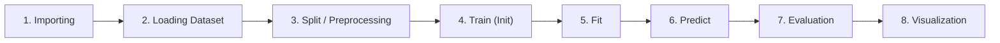
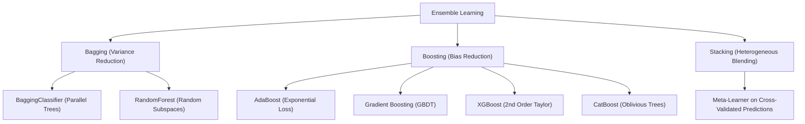
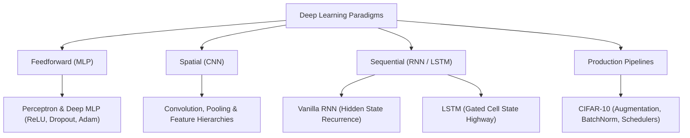

# Machine Learning & Deep Learning Engineering Reference Guide

A master laboratory handbook, theoretical reference, and beginner-friendly guide for modern Machine Learning and Deep Learning using **Scikit-Learn**, **MLxtend**, **XGBoost**, **CatBoost**, **PyTorch**, and **TensorFlow / Keras**.

This repository contains five standardized, self-contained educational notebooks engineered around an **8-Step Pedagogical Workflow**. Every algorithm is isolated with complete code implementations, explanatory documentation, plain-English ("Lemon / Layman's Language") analogies, diagnostic metrics, hardware acceleration (GPU/MPS/CPU), and publication-ready visualizations.

---

## 📑 Table of Contents
1. [Core Notebooks Overview](#-core-notebooks-overview)
2. [The 8-Step Pedagogical Template](#-the-8-step-pedagogical-template)
   - [🍋 The 8-Step Recipe in Plain English (The Master Chef Analogy)](#-the-8-step-recipe-in-plain-english-the-master-chef-analogy)
3. [Algorithmic Concepts, Logics & Formulations](#-algorithmic-concepts-logics--formulations)
   - [Part I: Supervised Learning](#part-i-supervised-learning)
   - [Part II: Unsupervised Learning](#part-ii-unsupervised-learning)
   - [Part III: Ensemble Learning](#part-iii-ensemble-learning)
   - [Part IV: Deep Learning & Neural Networks](#part-iv-deep-learning--neural-networks)
4. [Exhaustive API, Function & Module Reference](#-exhaustive-api-function--module-reference)
5. [Evaluation Metrics & Interpretation Guide](#-evaluation-metrics--interpretation-guide)
   - [🍋 Precision vs. Recall: The Boy Who Cried Wolf Analogy](#-precision-vs-recall-the-boy-who-cried-wolf-analogy)
6. [Curated Online Resources & Interactive Visualizers](#-curated-online-resources--interactive-visualizers)
7. [Environment Setup & Execution](#-environment-setup--execution)

---

## 📂 Core Notebooks Overview

All practical implementations reside in five master notebooks at the root of this repository:

| Notebook | Focus Area | Paradigms & Algorithms Covered | Primary Datasets |
|:---|:---|:---|:---|
| **[`Supervised.ipynb`](./Supervised.ipynb)** | Supervised Learning | Simple Linear Regression, Multiple Linear Regression, Polynomial Regression, Binary & Multiclass Logistic Regression, Decision Trees (Gini & Entropy), Naïve Bayes (Gaussian, Multinomial, Bernoulli) | Synthetic Regression, Diabetes, Breast Cancer Wisconsin, Iris |
| **[`Unsupervised.ipynb`](./Unsupervised.ipynb)** | Unsupervised Learning | Hierarchical (Agglomerative) Clustering, DBSCAN, K-Means Clustering, Association Rule Mining (Apriori), Dimensionality Reduction (TruncatedSVD vs. t-SNE), Principal Component Analysis (PCA) | Iris, Synthetic Blobs, Retail Transactions, Handwritten Digits, Breast Cancer |
| **[`Ensemble.ipynb`](./Ensemble.ipynb)** | Ensemble Learning | Bagging, Boosting (AdaBoost), Stacking (Heterogeneous Blending), Random Forest, Gradient Boosted Trees (GBDT), CatBoost, XGBoost, Benchmark Leaderboard | Breast Cancer Wisconsin |
| **[`NeuralNetworks_PyTorch.ipynb`](./NeuralNetworks_PyTorch.ipynb)** | Deep Learning (PyTorch) | Single-Layer Perceptron, Deep MLP, CNN, Vanilla RNN, Bidirectional LSTM, End-to-End CIFAR-10 Pipeline (GPU Acceleration) | MNIST Digits, Sentiment Sequences, CIFAR-10 |
| **[`NeuralNetworks_TensorFlow.ipynb`](./NeuralNetworks_TensorFlow.ipynb)** | Deep Learning (TensorFlow/Keras) | Single-Layer Perceptron, Deep MLP, CNN, Vanilla RNN, Bidirectional LSTM, End-to-End CIFAR-10 Pipeline (GPU Acceleration) | MNIST Digits, Sentiment Sequences, CIFAR-10 |

---

## 🔄 The 8-Step Pedagogical Template

To establish rigorous engineering discipline and cognitive predictability, every algorithm across all five notebooks strictly adheres to an identical **8-step workflow**:



### 🍋 The 8-Step Recipe in Plain English (The Master Chef Analogy)

If you have never built a machine learning model before, imagine you are a **Master Chef baking a world-class cake for a food critic**:

| Step | ML Workflow Stage | 🍋 Plain-English / Real-World Analogy |
|:---:|:---|:---|
| **1** | **Importing** | **Gathering Utensils & Cookbooks:** Before lighting the stove, you bring the bowls, mixers, and recipe cards onto your kitchen counter. In code, this means loading the exact tools and functions we need. |
| **2** | **Loading Dataset** | **Unpacking the Fresh Groceries:** You inspect the crate of eggs, flour, and sugar to see how much you have, whether any are cracked or missing, and how fresh they are. In code, we load the raw table of numbers and inspect its size. |
| **3** | **Split / Preprocessing** | **Washing, Peeling & Reserving Secret Samples:** You peel the carrots and wash the fruit so everything is clean and on the same scale. Crucially, you put aside 25% of the ingredients in a locked pantry so the baker cannot cheat by testing on them in advance! |
| **4** | **Train (Initialization)** | **Choosing the Appliance & Dial Settings:** You decide whether to use a convection oven or a wood-fired grill, and set the temperature dial. In code, this means choosing the algorithm and selecting its settings (hyperparameters). |
| **5** | **Fit** | **Baking in the Oven:** You put the batter into the heat and let the chemistry happen. This is the heavy computational work where the computer learns patterns from the training numbers. |
| **6** | **Predict** | **Serving a Slice to a Guest:** You pull out a freshly baked slice and serve it to a mystery guest to see what they think. The model guesses the answers for brand-new examples it has never seen before. |
| **7** | **Evaluation** | **The Food Critic's Scorecard:** The critic grades the cake: How moist is it? How sweet? Was anything burnt? In code, we measure how many guesses were right (Accuracy, Precision, Recall, $R^2$). |
| **8** | **Visualization** | **Plating & Food Photography:** You plate the dish beautifully with garnish and take clear photos. In code, we plot charts, decision boundaries, and trees so humans can see and trust the results with their own eyes. |

---

## 🧠 Algorithmic Concepts, Logics & Formulations

### Part I: Supervised Learning

#### 1. Linear Regression (Simple, Multiple, Polynomial)
> 🍋 **Layman's Analogy ("Explain Like I'm 5"):**
> Imagine you are taking a taxi. There is a base fee just for sitting in the car (say, \$3, which is the **intercept**), and then for every kilometer driven, the meter adds \$2 (the **slope**). 
> **Simple Linear Regression** finds the single straight line that best fits all your past taxi receipts so you can predict how much your next ride will cost.
> **Multiple Linear Regression** adds more factors: distance + traffic delay minutes + luggage bags.
> **Polynomial Regression** is like throwing a basketball. The ball does not fly in a straight stick; it follows a curved arc. If you try to force a straight ruler through it, you'll miss every point. Polynomial regression bends the ruler into a smooth curve so it catches the arc of the ball.

* **Underlying Logic:** Models the linear relationship between continuous dependent target $y$ and independent explanatory features $X$.
* **Mathematical Formulation:**
  $$\hat{y} = \theta_0 + \theta_1 x_1 + \theta_2 x_2 + \dots + \theta_n x_n = X\theta$$
* **Optimization Objective:** Ordinary Least Squares (OLS) minimizes the Residual Sum of Squares (RSS):
  $$J(\theta) = \frac{1}{2m} \sum_{i=1}^m \left(h_\theta(x^{(i)}) - y^{(i)}\right)^2$$
  Solved analytically via the Normal Equation:
  $$\theta = (X^T X)^{-1} X^T y$$
* **Polynomial Regression:** Expands feature space into non-linear combinations ($x \to [1, x, x^2, \dots, x^d]$) via `PolynomialFeatures(degree=d)`. While the relationship with $x$ is non-linear, it remains **linear in parameters $\theta$**, enabling OLS optimization.

---

#### 2. Logistic Regression (Binary & Multiclass Softmax)
> 🍋 **Layman's Analogy ("Explain Like I'm 5"):**
> Instead of predicting a continuous number (like house prices), you want to answer a Yes/No question: *"Will it rain tomorrow?"*
> If you used linear regression, it might tell you there is a 180% chance of rain, or a -30% chance—which makes no sense! 
> Logistic Regression takes any number and squashes it through an **S-shaped slide (the Sigmoid curve)** so the output is strictly between 0% and 100%. If the probability is above 50%, you grab an umbrella!

* **Underlying Logic:** A linear classification model that maps continuous linear combinations into probability intervals $[0, 1]$ using a non-linear link function.
* **Mathematical Formulation (Sigmoid):**
  $$P(y=1|x) = \sigma(z) = \frac{1}{1 + e^{-z}}, \quad \text{where } z = w^T x + b$$
* **Log-Odds (Logit):** $\ln\left(\frac{p}{1-p}\right) = w^T x + b$
* **Loss Function (Binary Cross-Entropy / Log Loss):**
  $$\mathcal{L}(w) = -\frac{1}{m} \sum_{i=1}^m \left[ y^{(i)} \ln(\hat{p}^{(i)}) + (1 - y^{(i)}) \ln(1 - \hat{p}^{(i)}) \right]$$
* **Multinomial (Softmax) Extension:** For $K > 2$ classes, probabilities are normalized across all classes:
  $$P(y=k|x) = \frac{e^{w_k^T x}}{\sum_{j=1}^K e^{w_j^T x}}$$

---

#### 3. Decision Trees (CART: Gini Impurity vs. Shannon Entropy)
> 🍋 **Layman's Analogy ("Explain Like I'm 5"):**
> Think of the classic game of **"20 Questions"** or a doctor's diagnostic checklist:
> *"Does the patient have a fever? Yes $\to$ Is there a cough? Yes $\to$ Diagnosis: Flu."*
> The Decision Tree automatically figures out which question divides the patients best so it can make an accurate diagnosis in the fewest possible questions.
> **What is Gini vs. Entropy?** Imagine a bowl of M&Ms. If the bowl only contains green M&Ms, it is 100% pure (Impurity = 0, Entropy = 0). If it has 10 mixed colors, it is complete chaos. Decision Trees pick the questions that turn chaotic mixed bowls into clean, pure single-color bowls.

* **Underlying Logic:** Non-parametric recursive binary splitting algorithm that partitions feature space into axis-aligned rectangular regions with homogeneous target distributions.
* **Splitting Criteria:**
  1. **Gini Impurity:** Measures the probability of misclassifying a randomly chosen element: $I_G(t) = 1 - \sum_{i=1}^C p_i^2$.
  2. **Shannon Entropy:** Measures information disorder / uncertainty in bits: $H(t) = -\sum_{i=1}^C p_i \log_2(p_i)$.
* **Information Gain:**
  $$IG(T, a) = H(T) - \sum_{v \in \text{values}(a)} \frac{|T_v|}{|T|} H(T_v)$$
* **Gini vs. Entropy:** Gini is computationally faster (avoids logarithmic operations) and tends to isolate the most frequent class, while Entropy often produces slightly more balanced trees.

---

#### 4. Naïve Bayes (Gaussian, Multinomial, Bernoulli)
> 🍋 **Layman's Analogy ("Explain Like I'm 5"):**
> Imagine an old-fashioned detective investigating a suspect on the street. The suspect is wearing a yellow raincoat, carrying a dripping umbrella, and splashing through puddles.
> A "naïve" detective treats each clue **independently**:
> - Clue 1: A raincoat strongly suggests it's raining outside.
> - Clue 2: An umbrella strongly suggests it's raining outside.
> - Clue 3: Puddles strongly suggest it's raining outside.
> The detective multiplies the evidence together without worrying if the raincoat caused the umbrella. Because the clues all align, the detective concludes with 99% confidence: *"It is raining!"*
> - **Gaussian NB:** For measuring continuous numbers (like body temperature or blood pressure).
> - **Multinomial NB:** For counting word occurrences (like how many times the word "WINNER" appears in spam email).
> - **Bernoulli NB:** For simple Yes/No checklists (like "did the email contain the word 'free' or not?").

* **Underlying Logic:** Probabilistic classifier founded on **Bayes' Theorem** with the "naïve" assumption of **conditional feature independence** given the class label.
* **Bayes' Theorem:**
  $$P(y|x_1, \dots, x_n) = \frac{P(y) \prod_{i=1}^n P(x_i|y)}{P(x_1, \dots, x_n)}$$
* **Variants by Likelihood Distribution $P(x_i|y)$:**
  - **Gaussian Naïve Bayes:** Assumes continuous features follow a Gaussian bell curve: $P(x_i|y) = \frac{1}{\sqrt{2\pi\sigma_y^2}} \exp\left( -\frac{(x_i - \mu_y)^2}{2\sigma_y^2} \right)$.
  - **Multinomial Naïve Bayes:** Designed for discrete counts or term frequencies: $P(x|y) \propto \prod_{i=1}^n \theta_{yi}^{x_i}$.
  - **Bernoulli Naïve Bayes:** Assumes binary boolean features ($x_i \in \{0, 1\}$), modeling feature presence vs. absence.

---

### Part II: Unsupervised Learning

#### 1. Hierarchical (Agglomerative) Clustering
> 🍋 **Layman's Analogy ("Explain Like I'm 5"):**
> Imagine building a family ancestry tree in reverse. On Day 1, every person in town stands alone. On Day 2, the closest twin brothers hold hands and form a pair. On Day 3, nearby cousins join in to form family groups. On Day 4, whole clans merge until everyone in town is connected into one giant tree.
> The **Dendrogram** is simply the family tree diagram. If you draw a horizontal line across it, you decide whether you want 3 large clans or 10 smaller families.

* **Underlying Logic:** Bottom-up clustering where each observation starts in its own cluster, and pairs of clusters are successively merged based on minimum linkage distance until a single tree remains.
* **Linkage Criteria:**
  - **Ward's Linkage (Default):** Minimizes total within-cluster variance increase upon merging: $\Delta \text{ESS}_{AB} = \frac{n_A n_B}{n_A + n_B} \|\mu_A - \mu_B\|^2$.
  - **Complete Linkage:** Maximum pairwise distance between points in clusters $A$ and $B$.
  - **Average Linkage:** Mean pairwise distance between points in clusters $A$ and $B$.

---

#### 2. Density-Based Spatial Clustering (DBSCAN)
> 🍋 **Layman's Analogy ("Explain Like I'm 5"):**
> Imagine looking down at Earth from an airplane at night. 
> Where streetlights and houses are packed tightly together, that is a bustling city (**Core Cluster**). Along the edges, quieter suburbs touch the city (**Border Points**).
> A lone lighthouse out in the middle of a dark, empty ocean belongs to no city at all—it is an outlier (**Noise Point, label -1**).
> Unlike other algorithms, DBSCAN doesn't force round circles and automatically spots the weirdly shaped islands while throwing away the lonely noise!

* **Underlying Logic:** Groups points based on spatial density reachability, allowing discovery of arbitrarily shaped clusters and automatic outlier isolation without specifying $k$ in advance.
* **Core Parameters:**
  - $\epsilon$ (`eps`): Radius of neighborhood around point $p$.
  - `min_samples`: Minimum number of points within $\epsilon$-radius for $p$ to be declared a **Core Point**.
* **Point Classifications:**
  - **Core Point:** $|N_\epsilon(p)| \ge \text{MinSamples}$ (neighborhood contains at least `min_samples` points).
  - **Border Point:** $|N_\epsilon(p)| \lt \text{MinSamples}$, but within $\epsilon$ of a core point.
  - **Noise Point (Outlier):** Neither core nor border point; assigned cluster label `-1`.

---

#### 3. K-Means Clustering
> 🍋 **Layman's Analogy ("Explain Like I'm 5"):**
> You are hired by a university to place **3 Wi-Fi routers** in a large student hall.
> 1. You drop 3 routers at random locations.
> 2. Each student connects to whichever router is closest to them.
> 3. At the end of the day, you pick up each router and move it to the exact middle (centroid) of the students connected to it.
> 4. You repeat this dance until the routers stop moving! That's K-Means.

* **Underlying Logic:** Partitioning algorithm that iteratively divides $N$ observations into $K$ disjoint clusters, minimizing intra-cluster variance (Within-Cluster Sum of Squares, WCSS).
* **Objective Function (Inertia):**
  $$\text{WCSS} = \sum_{k=1}^K \sum_{x \in C_k} \|x - \mu_k\|^2$$
* **Lloyd's Algorithm Steps:**
  1. Initialize $K$ cluster centroids (using `k-means++` smart seeding).
  2. **Assignment Step:** Assign each point $x$ to the nearest centroid $\mu_k$.
  3. **Update Step:** Recalculate centroids as the center of mass of all assigned points: $\mu_k = \frac{1}{|C_k|} \sum_{x \in C_k} x$.
  4. Repeat until centroid movement falls below tolerance `tol`.

---

#### 4. Association Rule Mining (Apriori & Lift)
> 🍋 **Layman's Analogy ("Explain Like I'm 5"):**
> Supermarket detectives analyze grocery receipts to discover: *"What items are bought together?"*
> If someone buys burger patties and burger buns, they are 85% likely to also buy ketchup (**Confidence**).
> **What is Lift?** If people buy ketchup 20% of the time normally, but buy ketchup 80% of the time when they have burgers, the burgers "lift" ketchup sales by 4x ($\text{Lift} = 4.0$). The supermarket uses this trick to place ketchup right beside the meat counter!

* **Underlying Logic:** Discovers interesting relationships, co-occurrences, and associations between items in transactional retail datasets.
* **The Apriori Principle (Anti-Monotonicity):** Any subset of a frequent itemset must also be frequent. If $\{A, B\}$ is infrequent, then $\{A, B, C\}$ cannot be frequent.
* **Evaluation Metrics:**
  - **Support:** Probability of transaction containing $A \cup B$: $\frac{\text{count}(A \cup B)}{N}$.
  - **Confidence:** Conditional probability of purchasing $B$ given $A$: $\frac{\text{Support}(A \cup B)}{\text{Support}(A)}$.
  - **Lift:** Ratio of observed joint support to expected support under independence: $\frac{\text{Confidence}(A \to B)}{\text{Support}(B)}$.

---

#### 5. Dimensionality Reduction (TruncatedSVD vs. t-SNE)
> 🍋 **Layman's Analogy ("Explain Like I'm 5"):**
> Imagine you have a 3D clay sculpture of a dragon with 64 tiny details.
> **TruncatedSVD** is like shining a spotlight on the dragon and casting a 2D shadow on the wall. You lose 3D depth, but you capture the main outline quickly.
> **t-SNE** is like peeling the skin off the dragon and pressing it flat onto a table like a world map, carefully stretching it so scales that were next to each other in 3D stay right next to each other on the table!

* **TruncatedSVD:** Linear matrix factorization ($X \approx U_k \Sigma_k V_k^T$) preserving global variance; ideal for sparse data.
* **t-SNE:** Non-linear manifold learning preserving local probabilities via Student-t distributions, minimizing Kullback-Leibler divergence.

---

#### 6. Principal Component Analysis (PCA)
> 🍋 **Layman's Analogy ("Explain Like I'm 5"):**
> Imagine you need to take a single 2D photograph of a bicycle.
> - If you take the photo directly from the front, it looks like a skinny straight pole—you can barely tell what it is!
> - If you take the photo from the side, you see the wheels, frame, handlebars, and pedals in full glory.
> **PCA is the mathematical camera operator** that rotates around your high-dimensional data and finds the exact angle that captures the maximum spread and detail in the fewest snapshots.

* **Underlying Logic:** Orthogonal linear transformation projecting data onto axes of maximum variance while eliminating multicollinearity.
* **Explained Variance Ratio:** $\text{EVR}_k = \frac{\lambda_k}{\sum_{j=1}^p \lambda_j}$

---

### Part III: Ensemble Learning

Ensemble learning combines multiple models to achieve far greater accuracy and reliability than any single model alone.



#### 1. Bagging (Bootstrap Aggregation)
> 🍋 **Layman's Analogy ("Explain Like I'm 5"):**
> **"The Wisdom of the Crowd."** If you ask one person to guess how many jellybeans are in a giant jar, their guess might be way too high or way too low. But if you ask 100 different people and average their guesses, the crazy high guesses cancel out the crazy low guesses, and the group average is astonishingly accurate! That is Bagging.

* **Underlying Logic:** Reduces model **variance** by training multiple independent base learners (deep trees) on different bootstrap subsets (sampling with replacement) and averaging predictions.
* **Variance Reduction:**
  $$\text{Var}(\bar{X}) = \rho \sigma^2 + \frac{1 - \rho}{n} \sigma^2$$
* **Out-of-Bag (OOB) Score:** The $\approx 36.8\%$ of samples omitted from each bootstrap fold act as an internal validation test.

---

#### 2. Boosting (AdaBoost)
> 🍋 **Layman's Analogy ("Explain Like I'm 5"):**
> Imagine a student practicing math problems with a smart tutor.
> On Test 1, the student gets questions #3 and #7 wrong.
> For Test 2, the tutor puts giant bright red stars on #3 and #7 and forces the student to spend 80% of their study time on them.
> By repeating this step-by-step, every new test focuses on the specific mistakes made previously until the student masters the entire subject!

* **Underlying Logic:** Sequentially trains weak base learners (decision stumps). Each subsequent model focuses on samples misclassified by previous models by increasing their weights.
* **Sample Weight Update:**
  $$w_{t+1}(i) = \frac{w_t(i) \exp(-\alpha_t y_i h_t(x_i))}{Z_t}$$

---

#### 3. Stacking (Stacked Generalization)
> 🍋 **Layman's Analogy ("Explain Like I'm 5"):**
> Imagine consulting a panel of diverse doctors for a tricky diagnosis:
> - Doctor 1 is a Radiologist (Random Forest).
> - Doctor 2 is a Cardiologist (KNN).
> - Doctor 3 is a General Physician (Naïve Bayes).
> Instead of just taking a simple vote, you hire a **Chief Medical Officer (the Meta-Learner)** who reviews all three doctors' opinions. The Chief knows that when blood tests look abnormal, Doctor 2 is usually most reliable, and gives their opinion extra weight to make the final diagnosis!

* **Underlying Logic:** Combines heterogeneous algorithms (e.g. Random Forest, KNN, Naïve Bayes). Level-0 models generate out-of-fold probability predictions, and a Level-1 meta-model (Logistic Regression) learns optimal blending weights.

---

#### 4. Random Forest Classifier
> 🍋 **Layman's Analogy ("Explain Like I'm 5"):**
> Imagine a murder mystery game with 100 detectives. If all 100 detectives look at the bloody fingerprint first, they all form the exact same theory and might get tricked together.
> In a **Random Forest**, you blindfold the detectives so each detective only gets to look at 3 random clues (e.g., Detective A only sees shoes and alibis; Detective B only sees phone logs and bank accounts). Because they look at completely different evidence, the forest as a whole cannot be fooled!

* **Underlying Logic:** Decorrelates trees by combining Bagging with the **Random Subspace Method** (evaluating only a random subset of $\sqrt{p}$ features at each split).

---

#### 5. Gradient Boosted Decision Trees (GBDT)
> 🍋 **Layman's Analogy ("Explain Like I'm 5"):**
> Imagine playing miniature golf. 
> - Your first putt lands 4 feet short of the hole (that 4-foot distance is your **error / residual**).
> - Your second stroke doesn't start from the beginning; it aims specifically to fix that 4-foot error!
> - Your third stroke fixes the remaining 2-inch error until the ball drops into the cup.
> Each new tree specifically targets and corrects the remaining errors of all previous trees.

* **Underlying Logic:** Fits sequential trees to the **negative gradients (pseudo-residuals)** of the loss function, gradually updating the ensemble with a shrinkage factor (`learning_rate`).

---

#### 6. CatBoost Classifier
> 🍋 **Layman's Analogy ("Explain Like I'm 5"):**
> A super-smart robot engine that loves words and categories! Most algorithms panic when they see words like "Toyota", "Ford", or "Blue" and demand you convert them into messy binary columns. CatBoost understands categories naturally and builds perfectly balanced, mirror-image decisions (**symmetric oblivious trees**) that make it blazing fast.

* **Underlying Logic:** Built by Yandex with **Oblivious Trees** (evaluating identical split conditions across all depth nodes) and **Ordered Boosting** to eliminate target leakage.

---

#### 7. XGBoost Classifier (Extreme Gradient Boosting)
> 🍋 **Layman's Analogy ("Explain Like I'm 5"):**
> The **Formula 1 racing car** of machine learning. It uses gradient boosting but is engineered with turbochargers (parallel processing) and smart disc brakes (**regularization**). The brakes prevent the car from memorizing the racetrack too closely (overfitting), allowing it to win machine learning competitions around the world!

* **Underlying Logic:** Optimized regularized gradient boosting using a second-order Taylor expansion with both first-order gradients ($g_i$) and second-order Hessians ($h_i$).

---

### Part IV: Deep Learning & Neural Networks

Deep Learning models are hierarchical feature extractors composed of stacked layers of parameterized matrix operations and non-linear transformations.



#### 1. Basics of Neural Networks (Perceptron & Deep MLP)
> 🍋 **Layman's Analogy ("Explain Like I'm 5"):**
> Imagine an orchestra where musicians are seated in rows. The front row (input layer) hears the conductor's cue. Each musician plays a note and adjusts their volume based on how loud their neighbor was playing (weights). The musicians in the middle rows (hidden layers) combine what they hear from the row ahead, blend the harmonies, and pass it back. The back row (output layer) produces the final grand chord. When the audience applauds or winces (the loss function), a critic walks backward through the orchestra (**backpropagation**), tapping individual musicians on the shoulder to tell them: *"Play a little softer next time,"* or *"Louder on that beat!"*

* **Underlying Logic:** A universal function approximator mapping input $\mathbf{x}$ to target $\hat{y}$ via compositions of parameterized linear projections and non-linear activations:
  $$z = \sum_{i=1}^n w_i x_i + b = \mathbf{w}^T \mathbf{x} + b, \quad a = \sigma(z)$$
* **Core Activation Functions:**
  - **Sigmoid:** $\sigma(z) = \frac{1}{1 + e^{-z}} \in (0, 1)$ — Maps outputs to probabilities; prone to gradient saturation when $|z|$ is large.
  - **ReLU (Rectified Linear Unit):** $\text{ReLU}(z) = \max(0, z)$ — Standard hidden activation avoiding vanishing gradients for positive inputs.
  - **Softmax:** $\text{Softmax}(z_k) = \frac{e^{z_k}}{\sum_{j=1}^C e^{z_j}}$ — Converts unconstrained logits into valid probability distributions over $C$ classes.
* **Loss Function (Categorical Cross-Entropy):**
  $$\mathcal{L} = -\sum_{c=1}^C y_c \log(\hat{y}_c)$$
* **🔬 Deep Layer Internals:**
  - **Linear / Dense Layer:** Forward transformation $\mathbf{Y} = \mathbf{X}\mathbf{W}^T + \mathbf{b}$. Parameter count: $D_{out} \times (D_{in} + 1)$. Initialized via He/Kaiming uniform or Xavier normal to preserve variance across depth.
  - **Backpropagation & Autodiff:** Gradients are calculated via the chain rule ($\frac{\partial \mathcal{L}}{\partial w_{ij}} = \delta_i \cdot x_j$). PyTorch constructs dynamic Directed Acyclic Graphs (DAGs) traversed via `loss.backward()`, while TensorFlow records operations on a `tf.GradientTape`.
  - **Dropout Regularization:** Randomly zeroes activations with probability $p$ and scales survivors by $\frac{1}{1-p}$ (inverted dropout), forcing neurons to learn redundant representations without co-dependency.
  - **Adam Optimizer:** Maintains exponentially decaying first moments ($m_t$, momentum) and second moments ($v_t$, adaptive scaling) to update parameters: $\theta_{t+1} = \theta_t - \frac{\eta}{\sqrt{\hat{v}_t} + \epsilon} \hat{m}_t$.

---

#### 2. Convolutional Neural Networks (CNN)
> 🍋 **Layman's Analogy ("Explain Like I'm 5"):**
> Imagine inspecting a giant museum painting with a magnifying glass. You don't try to swallow the entire wall in one glance. You slide your small circular lens (the **convolution filter**) row by row. At each spot, your magnifying glass checks for tiny brushstrokes: vertical lines, curves, corners. Later layers combine those small brushstroke detections into larger shapes (eyes, wheels, doors), and the final layer determines whether the painting is a portrait or a landscape!

* **Underlying Logic:** Preserves 2D grid topology and spatial correlation in images via local receptive fields, weight sharing, and spatial pooling.
* **Mathematical Formulation (2D Discrete Cross-Correlation):**
  $$\text{Output}(i, j, k) = \mathbf{b}_k + \sum_{c=1}^{C_{in}} \sum_{m} \sum_{n} \mathbf{X}(i \cdot S + m, j \cdot S + n, c) \cdot \mathbf{W}(m, n, c, k)$$
* **Spatial Output Sizing:**
  $$H_{out} = \left\lfloor \frac{H_{in} - K_h + 2P}{S} \right\rfloor + 1, \quad W_{out} = \left\lfloor \frac{W_{in} - K_w + 2P}{S} \right\rfloor + 1$$
* **🔬 Deep Layer Internals:**
  - **Parameter Efficiency:** A filter with $C_{in}=1, C_{out}=32, K=3\times3$ has only $32 \times (1 \times 9 + 1) = 320$ parameters, versus millions in a flattened dense layer.
  - **Max Pooling:** Computes $\max$ over non-overlapping windows (typically $2 \times 2$), halving height and width ($28 \times 28 \to 14 \times 14$) without learnable weights to confer translational invariance.

---

#### 3. Recurrent Neural Networks (RNN)
> 🍋 **Layman's Analogy ("Explain Like I'm 5"):**
> Imagine reading a suspense mystery novel. As you read word by word, you don't memorize every single past letter. Instead, you keep a running mental summary in your head: *"The detective just found a muddy footprint."* When you read the next word, you update your mental summary. The **hidden state** is that running mental summary!

* **Underlying Logic:** Models temporal dependencies across sequential tokens by maintaining an evolving internal hidden state vector $\mathbf{h}_t$.
* **Mathematical Formulation:**
  $$\mathbf{h}_t = \tanh(\mathbf{W}_{xh} \mathbf{x}_t + \mathbf{W}_{hh} \mathbf{h}_{t-1} + \mathbf{b})$$
* **🔬 Deep Layer Internals:**
  - **Embedding Layer:** High-cardinality discrete token IDs ($w_t \in [0, V-1]$) are transformed into continuous semantic vectors via lookup matrix $\mathbf{E} \in \mathbb{R}^{V \times D}$: $\mathbf{x}_t = \mathbf{E}[w_t, :]$.
  - **The Vanishing / Exploding Gradient Flaw:** During Backpropagation Through Time (BPTT), repeated matrix multiplications by $\mathbf{W}_{hh}^T$ cause error gradients to decay exponentially ($\|\mathbf{W}_{hh}\| < 1$) or explode ($\|\mathbf{W}_{hh}\| > 1$), preventing standard RNNs from learning dependencies beyond 5–10 timesteps.

---

#### 4. Long Short-Term Memory Networks (LSTM)
> 🍋 **Layman's Analogy ("Explain Like I'm 5"):**
> Think of an LSTM as a student studying for a history exam with a digital notebook.
> - The **Forget Gate** is the backspace key: it deletes outdated information (like a rumor that was proven false).
> - The **Input Gate** is the copy-paste tool: when the teacher says *"This will be on the final exam,"* it saves those key facts into the notebook.
> - The **Cell State** is the notebook itself — safely carrying important memories across all chapters.
> - The **Output Gate** is the student answering a specific quiz question based on what's currently in their notes.

* **Underlying Logic:** Solves the vanishing gradient problem via an additive, unconstrained **Cell State Highway** ($\mathbf{C}_t$) governed by three non-linear multiplicative gates.
* **The Four Gating Formulations:**
  1. **Forget Gate:** $\mathbf{f}_t = \sigma(\mathbf{W}_f \mathbf{x}_t + \mathbf{U}_f \mathbf{h}_{t-1} + \mathbf{b}_f) \in [0, 1]$ (what to erase).
  2. **Input Gate:** $\mathbf{i}_t = \sigma(\mathbf{W}_i \mathbf{x}_t + \mathbf{U}_i \mathbf{h}_{t-1} + \mathbf{b}_i)$ & candidate $\tilde{\mathbf{C}}_t = \tanh(\mathbf{W}_c \mathbf{x}_t + \mathbf{U}_c \mathbf{h}_{t-1} + \mathbf{b}_c)$ (what to store).
  3. **Cell State Update:** $\mathbf{C}_t = \mathbf{f}_t \odot \mathbf{C}_{t-1} + \mathbf{i}_t \odot \tilde{\mathbf{C}}_t$ (additive gradient flow).
  4. **Output Gate:** $\mathbf{o}_t = \sigma(\mathbf{W}_o \mathbf{x}_t + \mathbf{U}_o \mathbf{h}_{t-1} + \mathbf{b}_o), \quad \mathbf{h}_t = \mathbf{o}_t \odot \tanh(\mathbf{C}_t)$.
* **Bidirectional LSTM:** Processes sequences both left-to-right ($\overrightarrow{\mathbf{h}}_t$) and right-to-left ($\overleftarrow{\mathbf{h}}_t$), concatenating representations for complete contextual awareness.

---

#### 5. Practical Deep Learning Pipelines (CIFAR-10)
> 🍋 **Layman's Analogy ("Explain Like I'm 5"):**
> Building a production-grade neural network is like preparing a gourmet feast:
> - You need **quality ingredients** prepped properly (**Data Augmentation**: rotating and flipping pictures so the model doesn't just memorize one exact angle).
> - You need **temperature control** (**Batch Normalization**: keeping numbers from getting too wild or cold).
> - You need to **lower the flame** as the sauce simmers (**Learning Rate Scheduling**: taking smaller, gentler steps as the model nears perfection).
> - You save the best tasting batch in the fridge (**Model Checkpointing**: saving the best weights automatically).

* **Underlying Logic:** Combines data augmentation, normalization layers, adaptive learning rate schedules, and validation checkpointing for robust real-world generalization.
* **🔬 Deep Layer Internals:**
  - **Batch Normalization (`BatchNorm`):** Normalizes activations per mini-batch: $\hat{x}_i = \frac{x_i - \mu_B}{\sqrt{\sigma_B^2 + \epsilon}}$, followed by learnable affine scaling and shifting: $y_i = \gamma \hat{x}_i + \beta$. Eliminates internal covariate shift, enables higher learning rates, and acts as mild regularizer.
  - **In-Graph Data Augmentation:** Random crops, horizontal flips, and color jitters artificially expand training diversity, forcing models to learn invariant features rather than memorizing pixel coordinates.
  - **Learning Rate Scheduling:** Decays learning rates over time (e.g., `StepLR` or `ReduceLROnPlateau`), stabilizing optimization as parameters approach local minima.
  - **Automated Checkpointing:** Tracks validation accuracy and serializes optimal parameter weights (`.pt` or `.keras`), preventing post-training overfitting degradation.

---

#### 6. Architecture Selection Matrix & Framework Comparison

| Dimension | Multi-Layer Perceptron (MLP) | Convolutional Neural Network (CNN) | Recurrent Neural Network (RNN) | Long Short-Term Memory (LSTM) |
|:---|:---|:---|:---|:---|
| **Primary Domain** | Tabular records, independent vectors | Images, video, 2D/3D grid topologies | Short sequential sequences ($T < 10$) | Long-range text & temporal series |
| **Input Tensor Shape**| 1D Flattened $(B, D)$ | 4D Tensors $(B, C, H, W)$ or $(B, H, W, C)$| Sequential $(B, T, D)$ | Sequential $(B, T, D)$ |
| **Core Operation** | Fully connected $\mathbf{W}\mathbf{x} + \mathbf{b}$ | 2D Cross-correlation & pooling | Hidden recurrence $\mathbf{W}_{hh}\mathbf{h}_{t-1}$ | Gated additive cell highway |
| **Spatial Awareness** | ❌ None (destroys pixel coordinates) | ✅ Translation invariant, local filters | ❌ None | ❌ None |
| **Temporal Memory** | ❌ None | ❌ None | ⚠️ Short-range only | ✅ Long-range gated memory |
| **Vanishing Gradients**| Moderate (mitigated by ReLU) | Low (mitigated by BatchNorm/ResNet) | ❌ Critical flaw | ✅ Mitigated by additive cell updates |
| **Parameter Efficiency**| Low (dense all-to-all weights) | High (shared convolutional filters) | Moderate | Higher (4 internal gates per unit) |

##### Framework Paradigms: PyTorch vs. TensorFlow / Keras

| Feature | PyTorch (`torch`) | TensorFlow / Keras (`tf.keras`) |
|:---|:---|:---|
| **Model Creation** | Object-oriented `nn.Module` subclassing with explicit `forward()` method | Declarative `keras.Sequential` or Functional API (`keras.Model`) |
| **Training Execution** | Explicit manual loop: `zero_grad()` $\to$ `backward()` $\to$ `step()` | Automated compilation: `model.compile()` and `model.fit()` |
| **Hardware Management** | Explicit tensor/model device movement via `.to(device)` | Automatic GPU placement and memory allocation |
| **Inference Mode** | Explicit `model.eval()` mode with `torch.no_grad()` context manager | Handled automatically inside `model.predict()` and `model.evaluate()` |
| **Extensibility & Debugging**| Native Python debugging (`pdb`, print statements), dynamic graph | Built-in callbacks (`EarlyStopping`, `ModelCheckpoint`), deployment graph |

---

## 📚 Exhaustive API, Function & Module Reference

### 1. Estimators & Machine Learning Models

| Class / Function | Module | Key Parameters & Defaults | Inner Logic & Practical Purpose |
|:---|:---|:---|:---|
| `LinearRegression` | `sklearn.linear_model` | `fit_intercept=True` | Computes analytical OLS coefficients via LAPACK SVD decomposition. |
| `LogisticRegression` | `sklearn.linear_model` | `C=1.0`, `solver='lbfgs'`, `max_iter=1000` | Regularized binary/multinomial logistic regression; $C$ is inverse regularization strength ($1/\lambda$). |
| `DecisionTreeClassifier` | `sklearn.tree` | `criterion='gini'|'entropy'`, `max_depth=None`, `min_samples_split=2` | Recursive binary partitioning tree using CART; setting `max_depth` controls overfitting. |
| `GaussianNB` | `sklearn.naive_bayes` | `var_smoothing=1e-9` | Fits continuous Gaussian distributions per class; `var_smoothing` stabilizes zero-variance features. |
| `MultinomialNB` | `sklearn.naive_bayes` | `alpha=1.0` | Models discrete feature counts; `alpha` is Laplace smoothing parameter. |
| `BernoulliNB` | `sklearn.naive_bayes` | `binarize=0.0`, `alpha=1.0` | Models boolean indicators; values $> \text{binarize}$ mapped to 1. |
| `AgglomerativeClustering` | `sklearn.cluster` | `n_clusters=3`, `linkage='ward'` | Bottom-up hierarchical tree builder using Ward minimum variance criteria. |
| `DBSCAN` | `sklearn.cluster` | `eps=0.5`, `min_samples=5`, `metric='euclidean'` | Density clustering identifying cores, borders, and noise points (`-1`). |
| `KMeans` | `sklearn.cluster` | `n_clusters=3`, `init='k-means++'`, `n_init=10` | Lloyd's partitioning algorithm minimizing WCSS inertia. |
| `TruncatedSVD` | `sklearn.decomposition` | `n_components=2`, `random_state=42` | Fast low-rank linear matrix factorization without matrix centering. |
| `TSNE` | `sklearn.manifold` | `n_components=2`, `perplexity=30.0`, `random_state=42` | Non-linear manifold learning preserving local probabilities via KL-divergence. |
| `PCA` | `sklearn.decomposition` | `n_components=2`, `random_state=42` | Eigendecomposition of covariance matrix into orthogonal variance vectors. |
| `BaggingClassifier` | `sklearn.ensemble` | `estimator=DecisionTreeClassifier()`, `n_estimators=100`, `oob_score=True` | Parallel ensemble averaging bootstrapped base learners to slash variance. |
| `AdaBoostClassifier` | `sklearn.ensemble` | `estimator=DecisionTreeClassifier(max_depth=1)`, `n_estimators=100`, `learning_rate=0.5` | Sequential sample-weighted boosting using decision stumps. |
| `StackingClassifier` | `sklearn.ensemble` | `estimators=[...]`, `final_estimator=LogisticRegression()`, `cv=5` | Blends predictions from diverse base models into a level-1 meta-estimator. |
| `RandomForestClassifier` | `sklearn.ensemble` | `n_estimators=100`, `max_features='sqrt'`, `oob_score=True`, `n_jobs=-1` | Forest of decorrelated decision trees using random feature subspaces. |
| `GradientBoostingClassifier`| `sklearn.ensemble` | `n_estimators=100`, `learning_rate=0.1`, `max_depth=3`, `subsample=0.8` | Sequential gradient descent fitting trees to loss pseudo-residuals. |
| `CatBoostClassifier` | `catboost` | `iterations=100`, `learning_rate=0.1`, `depth=4`, `verbose=0` | Oblivious symmetric trees with native categorical handling and ordered boosting. |
| `XGBClassifier` | `xgboost` | `n_estimators=100`, `learning_rate=0.1`, `max_depth=4`, `eval_metric='logloss'` | Regularized gradient boosting leveraging 2nd-order Taylor expansions. |

### 2. Preprocessing & Feature Transformers

| Class / Function | Module | Key Parameters & Logic |
|:---|:---|:---|
| `train_test_split` | `sklearn.model_selection` | `test_size=0.25`, `stratify=y`, `random_state=42`. Partitions arrays into training and testing sets while preserving class balance. |
| `StandardScaler` | `sklearn.preprocessing` | Centers features to mean $\mu = 0$ and unit variance $\sigma = 1$: $z = \frac{x - \mu}{\sigma}$. Essential for distance-based models (KNN, PCA, SVM). |
| `MinMaxScaler` | `sklearn.preprocessing` | Rescales data to range $[0, 1]$: $x_{\text{scaled}} = \frac{x - x_{\min}}{x_{\max} - x_{\min}}$. Necessary for non-negative models like `MultinomialNB`. |
| `Binarizer` | `sklearn.preprocessing` | `threshold=0.0`. Maps continuous features to binary values ($1$ if $> \text{threshold}$, else $0$). Required for `BernoulliNB`. |
| `PolynomialFeatures` | `sklearn.preprocessing` | `degree=2`, `include_bias=False`. Computes interaction terms and polynomial powers ($x_1^2, x_1 x_2, x_2^2$). |
| `make_pipeline` | `sklearn.pipeline` | Chains transformers and an estimator into a single atomic scikit-learn interface, preventing data leakage during cross-validation. |
| `TransactionEncoder` | `mlxtend.preprocessing` | Transforms nested transaction lists into a boolean one-hot encoded matrix for frequent itemset mining. |
| `apriori` | `mlxtend.frequent_patterns` | `min_support=0.3`, `use_colnames=True`. Generates frequent itemsets satisfying minimum support thresholds. |
| `association_rules` | `mlxtend.frequent_patterns` | `metric='lift'`, `min_threshold=1.0`. Extracts association rules $(A \to B)$ and computes Support, Confidence, and Lift. |

### 3. Evaluation Metrics & Diagnostics

| Class / Function | Module | Usage & Meaning |
|:---|:---|:---|
| `accuracy_score` | `sklearn.metrics` | Fraction of correct classifications: $\frac{TP + TN}{N}$. |
| `classification_report` | `sklearn.metrics` | Formatted summary of Precision, Recall, F1-Score, and Support across each class. |
| `confusion_matrix` | `sklearn.metrics` | Matrix displaying raw counts of True Positives, False Positives, True Negatives, and False Negatives. |
| `ConfusionMatrixDisplay`| `sklearn.metrics` | Visualizes the confusion matrix as a Seaborn-style annotated heatmap. |
| `roc_curve`, `auc` | `sklearn.metrics` | Computes True Positive Rate vs. False Positive Rate across all thresholds; Area Under Curve measures discriminative ability. |
| `mean_squared_error` | `sklearn.metrics` | $\text{MSE} = \frac{1}{n} \sum (y_i - \hat{y}_i)^2$. Penalizes large regression errors quadratically. |
| `r2_score` | `sklearn.metrics` | $R^2 = 1 - \frac{\sum (y_i - \hat{y}_i)^2}{\sum (y_i - \bar{y})^2}$. Proportion of variance explained by the model ($1.0$ is perfect). |
| `silhouette_score` | `sklearn.metrics` | Measures cluster separation and cohesion ($s \in [-1, 1]$; values $> 0.5$ indicate well-defined clusters). |
| `davies_bouldin_score`| `sklearn.metrics` | Average similarity measure between each cluster and its most similar one (lower values indicate better clustering). |
| `calinski_harabasz_score`| `sklearn.metrics` | Variance Ratio Criterion: ratio of between-cluster dispersion to within-cluster dispersion (higher is better). |
| `log_loss` | `sklearn.metrics` | Multi-class cross-entropy loss evaluating probabilistic calibration. |

### 4. Deep Learning Frameworks (PyTorch & TensorFlow / Keras)

| Class / Function | Module / Framework | Key Parameters & Defaults | Inner Logic & Practical Purpose |
|:---|:---|:---|:---|
| `torch.nn.Linear` | `torch.nn` (PyTorch) | `in_features`, `out_features`, `bias=True` | Fully connected affine linear projection: $\mathbf{Y} = \mathbf{X}\mathbf{W}^T + \mathbf{b}$. |
| `torch.nn.Conv2d` | `torch.nn` (PyTorch) | `in_channels`, `out_channels`, `kernel_size`, `padding=0`, `stride=1` | 2D spatial cross-correlation convolution producing hierarchical feature maps. |
| `torch.nn.MaxPool2d` | `torch.nn` (PyTorch) | `kernel_size=2`, `stride=2` | Spatial downsampling extracting max window values without learnable parameters. |
| `torch.nn.BatchNorm2d`| `torch.nn` (PyTorch) | `num_features`, `eps=1e-5`, `momentum=0.1` | Normalizes mini-batch channel activations with learnable affine parameters $\gamma, \beta$. |
| `torch.nn.Dropout` | `torch.nn` (PyTorch) | `p=0.5` | Regularization randomly zeroing neurons and scaling survivors by $\frac{1}{1-p}$ during training. |
| `torch.nn.Embedding` | `torch.nn` (PyTorch) | `num_embeddings`, `embedding_dim`, `padding_idx=None` | Discrete integer token lookup table mapping word IDs into dense semantic vectors. |
| `torch.nn.RNN` | `torch.nn` (PyTorch) | `input_size`, `hidden_size`, `batch_first=True` | Vanilla recurrent network maintaining hidden state transitions across sequence steps. |
| `torch.nn.LSTM` | `torch.nn` (PyTorch) | `input_size`, `hidden_size`, `batch_first=True`, `bidirectional=True` | 3-gate long short-term memory recurrent layer with additive cell state gradient highway. |
| `torch.nn.CrossEntropyLoss` | `torch.nn` (PyTorch) | `reduction='mean'` | Combines `LogSoftmax` and `NLLLoss` for stable multi-class probability optimization. |
| `torch.optim.Adam` | `torch.optim` (PyTorch)| `lr=0.001`, `betas=(0.9, 0.999)`, `weight_decay=0` | Adaptive moment optimizer tracking first ($m_t$) and second ($v_t$) gradient moments. |
| `torch.utils.data.DataLoader` | `torch.utils.data` (PyTorch) | `dataset`, `batch_size=64`, `shuffle=True`, `num_workers=0` | Multithreaded mini-batch iterator, data shuffler, and tensor batcher. |
| `tf.keras.Sequential` | `tensorflow.keras` | `layers=[]` | High-level linear container chaining layers in sequential execution order. |
| `tf.keras.layers.Dense`| `tensorflow.keras.layers` | `units`, `activation=None`, `use_bias=True` | Fully connected layer with integrated activation function and bias. |
| `tf.keras.layers.Conv2D`| `tensorflow.keras.layers`| `filters`, `kernel_size=(3,3)`, `padding='same'`, `activation='relu'` | 2D convolution layer supporting in-graph padding and activation. |
| `tf.keras.layers.LSTM`| `tensorflow.keras.layers`| `units`, `return_sequences=False` | Recurrent LSTM layer with optional sequence return or final hidden state output. |
| `model.compile` | `tf.keras.Model` | `optimizer='adam'`, `loss='sparse_categorical_crossentropy'`, `metrics=['accuracy']` | Configures learning mechanics, loss metrics, and optimizer graph. |
| `model.fit` | `tf.keras.Model` | `x`, `y`, `epochs=5`, `batch_size=64`, `validation_split=0.1`, `callbacks=[]` | High-level training execution loop monitoring validation metrics and callbacks. |
| `callbacks.ModelCheckpoint` | `tensorflow.keras.callbacks` | `filepath`, `monitor='val_accuracy'`, `save_best_only=True` | Automatically persists optimal model weights to disk during training. |

---

## 📊 Evaluation Metrics & Interpretation Guide

### 🍋 Precision vs. Recall: The Boy Who Cried Wolf Analogy

$$\begin{array}{c|c|c}
& \textbf{Predicted Normal (0)} & \textbf{Predicted Wolf (1)} \\
\hline
\textbf{No Wolf (0)} & \text{True Negative (TN) - Peaceful day} & \text{False Positive (FP) - Boy screams 'Wolf!' but no wolf} \\
\hline
\textbf{Real Wolf (1)} & \text{False Negative (FN) - Wolf sneaks in, boy was silent!} & \text{True Positive (TP) - Boy screams 'Wolf!' and wolf is caught!} \\
\end{array}$$

* **Precision:** *"When the boy yells 'Wolf!', how often is there ACTUALLY a wolf?"*
  - **High Precision** means the boy rarely gives false alarms.
  - **When to care most about Precision:** Spam email filter. If the filter marks an important job offer email as spam (False Positive), you might lose your dream job!
* **Recall:** *"Out of all the wolves that actually attacked the village, what percentage did the boy catch?"*
  - **High Recall** means no wolf ever sneaks into the village undetected.
  - **When to care most about Recall:** Medical Cancer Screening. If a patient actually has cancer but the test says they are healthy (False Negative), they will miss life-saving treatment! We would rather give 10 healthy people a harmless second test than miss 1 actual sick patient.
* **Accuracy:** $\frac{TP + TN}{N}$ — Overall test score percentage.
* **F1-Score:** The harmonic balance between Precision and Recall.

---

## 🌐 Curated Online Resources & Interactive Visualizers

### 1. Interactive Visualizers & Algorithmic Simulators

| Resource | URL & Tool | What Concepts to Explore |
|:---|:---|:---|
| **Naftali Harris Clustering Visualizers** | [Visualizing K-Means Clustering](https://www.naftaliharris.com/blog/visualizing-k-means-clustering/)<br>[Visualizing DBSCAN Clustering](https://www.naftaliharris.com/blog/visualizing-dbscan-clustering/) | Step-by-step interactive animations showing centroid jumps in Lloyd's algorithm and $\epsilon$-density wave propagation in DBSCAN across non-convex smiley/spiral datasets. |
| **Distill.pub t-SNE Interactive Guide** | [How to Use t-SNE Effectively](https://distill.pub/2016/misread-tsne/) | Interactive widgets showing how perplexity, step size, and cluster distance behave under t-SNE projections; clarifies why distance between clusters cannot be interpreted literally. |
| **Seeing Theory (Brown University)** | [Seeing Theory: Visual Statistics](https://seeing-theory.brown.edu/) | Visual explainers of Bayes' Theorem, Compound Probabilities, Regression lines, and confidence intervals. |
| **TensorFlow Playground** | [playground.tensorflow.org](https://playground.tensorflow.org/) | Real-time browser playground showing decision boundary morphing, non-linear feature expansion, and overfitting. |
| **MLU-Explain (Amazon Machine Learning)** | [MLU-Explain Visual Articles](https://mlu-explain.github.io/) | Beautiful visual, interactive articles on Decision Trees, Random Forests, Logistic Regression, Linear Regression, and ROC/AUC curves. |

### 2. Conceptual Video Breakdowns & Lecture Series

* **[StatQuest with Josh Starmer](https://www.youtube.com/@statquest)**
  - *Decision Trees:* Step-by-step Gini Impurity calculation.
  - *Random Forests:* Out-of-Bag error and random feature subspace intuition.
  - *AdaBoost & Gradient Boost:* Visual weight adjustment and residual gradient descent.
  - *XGBoost:* Detailed explanation of Cover, Similarity Score, and Pruning $\gamma$.
  - *PCA:* Visual 3D projection onto orthogonal eigenvectors.
* **[3Blue1Brown: Essence of Linear Algebra](https://www.3blue1brown.com/topics/linear-algebra)**
  - Deep geometric intuition for matrices as linear transformations, dot products, determinants, and Eigenvectors / Eigenvalues (crucial for PCA and SVD).
* **[3Blue1Brown: Neural Networks Series](https://www.youtube.com/playlist?list=PLZHQObOWTQDNU6R1_67000Dx_ZCJB-3pi)**
  - Chapters 1–4: What is a neural network, Gradient descent, Backpropagation intuition, and Backpropagation calculus.
* **[Andrej Karpathy: Neural Networks — Zero to Hero](https://karpathy.ai/zero-to-hero.html)**
  - Comprehensive masterclass building `micrograd`, MLPs, BatchNorm, WaveNet, and GPT from scratch in pure Python/PyTorch.
  - Classic Essays: [Yes you should understand backprop](https://karpathy.medium.com/yes-you-should-understand-backprop-e034f7dafdb0), [The Unreasonable Effectiveness of RNNs](https://karpathy.github.io/2015/05/21/rnn-effectiveness/), [A Recipe for Training Neural Networks](https://karpathy.github.io/2019/04/25/recipe/).
* **[Stanford University Deep Learning Courses](https://online.stanford.edu/)**
  - **CS231n:** Convolutional Neural Networks for Visual Recognition (Fei-Fei Li, Justin Johnson).
  - **CS224n:** Natural Language Processing with Deep Learning (Christopher Manning).
* **[Christopher Olah & Jay Alammar Visual Guides](https://colah.github.io/)**
  - [Understanding LSTM Networks](https://colah.github.io/posts/2015-08-Understanding-LSTMs/) — The definitive illustrated walkthrough of LSTM gates.
  - [The Illustrated Transformer](https://jalammar.github.io/illustrated-transformer/) — Visual guide to attention mechanisms and Transformers.

### 3. Foundational Open-Access Textbooks

* **[An Introduction to Statistical Learning (ISLP)](https://www.statlearning.com/)** — Gareth James, Daniela Witten, Trevor Hastie, Robert Tibshirani. (Free PDF).
* **[The Elements of Statistical Learning (ESL)](https://hastie.su.domains/ElemStatLearn/)** — Trevor Hastie, Robert Tibshirani, Jerome Friedman.
* **[Deep Learning](https://www.deeplearningbook.org/)** — Ian Goodfellow, Yoshua Bengio, Aaron Courville.
* **[Dive into Deep Learning (D2L.ai)](https://d2l.ai/)** — Interactive textbook with PyTorch, TensorFlow, and JAX code.
* **[Hands-On Machine Learning with Scikit-Learn, Keras, and TensorFlow](https://github.com/ageron/handson-ml3)** — Aurélien Géron.

### 4. Official Documentation & User Guides

* [Scikit-Learn Official User Guide](https://scikit-learn.org/stable/user_guide.html)
* [PyTorch Official Documentation & Tutorials](https://pytorch.org/docs/stable/index.html)
* [TensorFlow & Keras Official Guide](https://www.tensorflow.org/guide)
* [XGBoost Official Python Documentation](https://xgboost.readthedocs.io/en/stable/python/index.html)
* [CatBoost Official Documentation](https://catboost.ai/en/docs/)
* [MLxtend (Machine Learning Extensions) Documentation](https://rasbt.github.io/mlxtend/)

---

## 💻 Environment Setup & Execution

### 1. Prerequisites
- Python 3.10+ (64-bit recommended)
- Git

### 2. Virtual Environment Setup
Clone the repository and initialize a virtual environment:

```powershell
# Clone repository
git clone https://github.com/<your-repo>/ACC-HPC2026-AIML.git
cd ACC-HPC2026-AIML

# Create virtual environment
python -m venv .venv

# Activate environment (Windows PowerShell)
.\.venv\Scripts\Activate.ps1

# Upgrade pip
python -m pip install --upgrade pip
```

### 3. Install Dependencies
Install all core machine learning and deep learning libraries using `requirements.txt`:

```powershell
pip install -r requirements.txt
```

### 4. Launch Jupyter Notebooks
Launch Jupyter Lab or open any notebook directly in VS Code / Cursor:

```powershell
jupyter lab
```

Open:
- [`Supervised.ipynb`](./Supervised.ipynb) for regression, logistic models, trees, and Naïve Bayes.
- [`Unsupervised.ipynb`](./Unsupervised.ipynb) for clustering, association rules, SVD/t-SNE, and PCA.
- [`Ensemble.ipynb`](./Ensemble.ipynb) for bagging, boosting, stacking, and benchmark leaderboards.
- [`NeuralNetworks_PyTorch.ipynb`](./NeuralNetworks_PyTorch.ipynb) for Deep Learning using PyTorch (Perceptron, MLP, CNN, RNN, LSTM, CIFAR-10).
- [`NeuralNetworks_TensorFlow.ipynb`](./NeuralNetworks_TensorFlow.ipynb) for Deep Learning using TensorFlow / Keras (Perceptron, MLP, CNN, RNN, LSTM, CIFAR-10).
