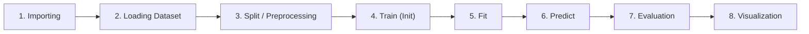
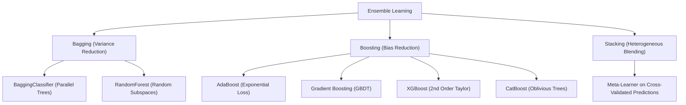

# Machine Learning Engineering & Pedagogical Reference Guide

A master laboratory handbook, theoretical reference, and API guide for modern Machine Learning using **Scikit-Learn**, **MLxtend**, **XGBoost**, and **CatBoost**.

This repository contains three standardized, self-contained educational notebooks engineered around an **8-Step Pedagogical Workflow**. Every algorithm is isolated with complete code implementations, explanatory documentation, diagnostic metrics, and publication-ready visualizations.

---

## 📑 Table of Contents
1. [Core Notebooks Overview](#-core-notebooks-overview)
2. [The 8-Step Pedagogical Template](#-the-8-step-pedagogical-template)
3. [Algorithmic Concepts, Logics & Formulations](#-algorithmic-concepts-logics--formulations)
   - [Part I: Supervised Learning](#part-i-supervised-learning)
   - [Part II: Unsupervised Learning](#part-ii-unsupervised-learning)
   - [Part III: Ensemble Learning](#part-iii-ensemble-learning)
4. [Exhaustive API, Function & Module Reference](#-exhaustive-api-function--module-reference)
5. [Evaluation Metrics & Interpretation Guide](#-evaluation-metrics--interpretation-guide)
6. [Curated Online Resources & Interactive Visualizers](#-curated-online-resources--interactive-visualizers)
7. [Environment Setup & Execution](#-environment-setup--execution)

---

## 📂 Core Notebooks Overview

All practical implementations reside in three master notebooks at the root of this repository:

| Notebook | Focus Area | Paradigms & Algorithms Covered | Primary Datasets |
|:---|:---|:---|:---|
| **[`Supervised.ipynb`](file:///d:/Github/ACC-HPC2026-AIML/Supervised.ipynb)** | Supervised Learning | Simple Linear Regression, Multiple Linear Regression, Polynomial Regression, Binary & Multiclass Logistic Regression, Decision Trees (Gini & Entropy), Naïve Bayes (Gaussian, Multinomial, Bernoulli) | Synthetic Regression, Diabetes, Breast Cancer Wisconsin, Iris |
| **[`Unsupervised.ipynb`](file:///d:/Github/ACC-HPC2026-AIML/Unsupervised.ipynb)** | Unsupervised Learning | Hierarchical (Agglomerative) Clustering, DBSCAN, K-Means Clustering, Association Rule Mining (Apriori), Dimensionality Reduction (TruncatedSVD vs. t-SNE), Principal Component Analysis (PCA) | Iris, Synthetic Blobs, Retail Transactions, Handwritten Digits, Breast Cancer |
| **[`Ensemble.ipynb`](file:///d:/Github/ACC-HPC2026-AIML/Ensemble.ipynb)** | Ensemble Learning | Bagging, Boosting (AdaBoost), Stacking (Heterogeneous Blending), Random Forest, Gradient Boosted Trees (GBDT), CatBoost, XGBoost, Benchmark Leaderboard | Breast Cancer Wisconsin |

---

## 🔄 The 8-Step Pedagogical Template

To establish rigorous engineering discipline and cognitive predictability, every algorithm in all three notebooks strictly adheres to an identical **8-step workflow**:



### Why This Workflow Matters in Machine Learning Engineering:

1. **Step 1: Importing (Modularity & Namespace Isolation)**
   - *Logic:* Every sub-section imports strictly what it requires. This avoids "hidden dependency syndrome" where running cells out of sequence causes `NameError`, and teaches students which exact submodule houses each class.
2. **Step 2: Loading Dataset (Data Topology & Sanity Inspection)**
   - *Logic:* Data is converted to a `pandas.DataFrame` where shapes, feature types, class balances, and target distributions are explicitly verified before any modelling commences.
3. **Step 3: Split / Preprocessing (Information Leakage Prevention)**
   - *Logic:* In supervised pipelines, `train_test_split` partitions data prior to fitting scalers (`StandardScaler`, `MinMaxScaler`), preventing test-set data snooping. In unsupervised workflows, distance-dependent algorithms are scaled here.
4. **Step 4: Train (Inductive Bias & Hyperparameter Configuration)**
   - *Logic:* Model architectures are initialized without fitting (`clf = Model(params...)`). This isolates parameter tuning (e.g., `criterion`, `n_estimators`, `max_depth`, `learning_rate`) from the numerical optimization step.
5. **Step 5: Fit (Optimization & Parameter Estimation)**
   - *Logic:* The actual computational training step (`.fit(X_train, y_train)` or `.fit(X_scaled)`). Here, loss functions are minimized, weight vectors calculated, or spatial centroids iteratively updated.
6. **Step 6: Predict (Inference & Latent Projection)**
   - *Logic:* Running inference strictly on unseen data (`.predict(X_test)` or `.predict_proba(X_test)`). For clustering, this assigns cluster labels; for dimensionality reduction, it projects into lower-dimensional manifolds.
7. **Step 7: Evaluation (Objective Quantitative Diagnostics)**
   - *Logic:* Rigorous metrics extraction. Rather than relying solely on accuracy, comprehensive classification reports (Precision, Recall, F1), confusion matrices, $R^2$ scores, or cluster silhouette scores are computed.
8. **Step 8: Visualization (Cognitive Validation & Interpretability)**
   - *Logic:* Diagnostic plotting: residual distributions, decision surfaces, ROC curves, tree hierarchy diagrams, dendrograms, or staged loss progressions.

---

## 🧠 Algorithmic Concepts, Logics & Formulations

### Part I: Supervised Learning

#### 1. Linear Regression (Simple, Multiple, Polynomial)
* **Underlying Logic:** Models the linear relationship between continuous dependent target $y$ and independent explanatory features $X$.
* **Mathematical Formulation:**
  $$\hat{y} = \theta_0 + \theta_1 x_1 + \theta_2 x_2 + \dots + \theta_n x_n = X\theta$$
* **Optimization Objective:** Ordinary Least Squares (OLS) minimizes the Residual Sum of Squares (RSS):
  $$J(\theta) = \frac{1}{2m} \sum_{i=1}^m \left(h_\theta(x^{(i)}) - y^{(i)}\right)^2$$
  Solved analytically via the Normal Equation:
  $$\theta = (X^T X)^{-1} X^T y$$
* **Polynomial Regression:** Expands feature space into non-linear combinations ($x \to [1, x, x^2, \dots, x^d]$) via `PolynomialFeatures(degree=d)`. While the relationship with $x$ is non-linear, it remains **linear in parameters $\theta$**, enabling OLS optimization.

#### 2. Logistic Regression (Binary & Multiclass Softmax)
* **Underlying Logic:** A linear classification model that maps continuous linear combinations into probability intervals $[0, 1]$ using a non-linear link function.
* **Mathematical Formulation (Sigmoid):**
  $$P(y=1|x) = \sigma(z) = \frac{1}{1 + e^{-z}}, \quad \text{where } z = w^T x + b$$
* **Log-Odds (Logit):** $\ln\left(\frac{p}{1-p}\right) = w^T x + b$
* **Loss Function (Binary Cross-Entropy / Log Loss):**
  $$\mathcal{L}(w) = -\frac{1}{m} \sum_{i=1}^m \left[ y^{(i)} \ln(\hat{p}^{(i)}) + (1 - y^{(i)}) \ln(1 - \hat{p}^{(i)}) \right]$$
* **Multinomial (Softmax) Extension:** For $K > 2$ classes, probabilities are normalized across all classes:
  $$P(y=k|x) = \frac{e^{w_k^T x}}{\sum_{j=1}^K e^{w_j^T x}}$$

#### 3. Decision Trees (CART: Gini Impurity vs. Shannon Entropy)
* **Underlying Logic:** Non-parametric recursive binary splitting algorithm that partitions feature space into axis-aligned rectangular regions with homogeneous target distributions.
* **Splitting Criteria:**
  1. **Gini Impurity:** Measures the probability of misclassifying a randomly chosen element:
     $$I_G(t) = 1 - \sum_{i=1}^C p_i^2$$
  2. **Shannon Entropy:** Measures information disorder / uncertainty in bits:
     $$H(t) = -\sum_{i=1}^C p_i \log_2(p_i)$$
* **Information Gain:**
  $$IG(T, a) = H(T) - \sum_{v \in \text{values}(a)} \frac{|T_v|}{|T|} H(T_v)$$
* **Gini vs. Entropy:** Gini is computationally faster (avoids logarithmic operations) and tends to isolate the most frequent class, while Entropy often produces slightly more balanced trees.

#### 4. Naïve Bayes (Gaussian, Multinomial, Bernoulli)
* **Underlying Logic:** Probabilistic classifier founded on **Bayes' Theorem** with the "naïve" assumption of **conditional feature independence** given the class label.
* **Bayes' Theorem:**
  $$P(y|x_1, \dots, x_n) = \frac{P(y) \prod_{i=1}^n P(x_i|y)}{P(x_1, \dots, x_n)}$$
* **Variants by Likelihood Distribution $P(x_i|y)$:**
  - **Gaussian Naïve Bayes:** Assumes continuous features follow a Gaussian bell curve:
    $$P(x_i|y) = \frac{1}{\sqrt{2\pi\sigma_y^2}} \exp\left( -\frac{(x_i - \mu_y)^2}{2\sigma_y^2} \right)$$
  - **Multinomial Naïve Bayes:** Designed for discrete counts or term frequencies (e.g., text document classification, word frequencies):
    $$P(x|y) \propto \prod_{i=1}^n \theta_{yi}^{x_i}$$
  - **Bernoulli Naïve Bayes:** Assumes binary boolean features ($x_i \in \{0, 1\}$), modeling word occurrence vs. absence.

---

### Part II: Unsupervised Learning

#### 1. Hierarchical (Agglomerative) Clustering
* **Underlying Logic:** Bottom-up clustering where each observation starts in its own cluster, and pairs of clusters are successively merged based on minimum linkage distance until a single tree remains.
* **Linkage Criteria:**
  - **Ward's Linkage (Default):** Minimizes total within-cluster variance increase upon merging:
    $$\Delta \text{ESS}_{AB} = \frac{n_A n_B}{n_A + n_B} \|\mu_A - \mu_B\|^2$$
  - **Complete Linkage:** Maximum pairwise distance between points in clusters $A$ and $B$.
  - **Average Linkage:** Mean pairwise distance between points in clusters $A$ and $B$.
* **Dendrogram:** Tree representation displaying the cophenetic distance at which each merge occurred; cutting horizontally across the largest vertical gap identifies the optimal cluster count.

#### 2. Density-Based Spatial Clustering (DBSCAN)
* **Underlying Logic:** Groups points based on spatial density reachability, allowing discovery of arbitrarily shaped clusters and automatic outlier isolation without specifying $k$ in advance.
* **Core Parameters:**
  - $\epsilon$ (`eps`): Radius of neighborhood around point $p$.
  - `min_samples`: Minimum number of points within $\epsilon$-radius for $p$ to be declared a **Core Point**.
* **Point Classifications:**
  - **Core Point:** $|N_\epsilon(p)| \ge \text{min\_samples}$.
  - **Border Point:** $|N_\epsilon(p)| < \text{min\_samples}$, but within $\epsilon$ of a core point.
  - **Noise Point (Outlier):** Neither core nor border point; assigned cluster label `-1`.

#### 3. K-Means Clustering
* **Underlying Logic:** Partitioning algorithm that iteratively divides $N$ observations into $K$ disjoint clusters, minimizing intra-cluster variance (Within-Cluster Sum of Squares, WCSS).
* **Objective Function (Inertia):**
  $$\text{WCSS} = \sum_{k=1}^K \sum_{x \in C_k} \|x - \mu_k\|^2$$
* **Lloyd's Algorithm Steps:**
  1. Initialize $K$ cluster centroids (using `k-means++` smart seeding).
  2. **Assignment Step:** Assign each point $x$ to the nearest centroid $\mu_k$.
  3. **Update Step:** Recalculate centroids as the center of mass of all assigned points: $\mu_k = \frac{1}{|C_k|} \sum_{x \in C_k} x$.
  4. Repeat until centroid movement falls below tolerance `tol`.
* **Heuristics for Optimal $K$:**
  - **Elbow Method:** Plot Inertia vs. $K$; choose point of diminishing marginal returns (the "elbow").
  - **Silhouette Analysis:** Measures how similar a point is to its own cluster compared to neighboring clusters.

#### 4. Association Rule Mining (Apriori & Lift)
* **Underlying Logic:** Discovers interesting relationships, co-occurrences, and associations between items in transactional retail datasets.
* **The Apriori Principle (Anti-Monotonicity):** Any subset of a frequent itemset must also be frequent. If $\{A, B\}$ is infrequent, then $\{A, B, C\}$ cannot be frequent.
* **Evaluation Metrics:**
  - **Support:** Probability that a transaction contains itemset $A \cup B$:
    $$\text{Support}(A \to B) = P(A \cup B) = \frac{\text{count}(A \cup B)}{N}$$
  - **Confidence:** Conditional probability of purchasing $B$ given $A$ was purchased:
    $$\text{Confidence}(A \to B) = P(B|A) = \frac{\text{Support}(A \cup B)}{\text{Support}(A)}$$
  - **Lift:** Ratio of observed joint support to expected support if $A$ and $B$ were statistically independent:
    $$\text{Lift}(A \to B) = \frac{\text{Confidence}(A \to B)}{\text{Support}(B)} = \frac{P(A \cup B)}{P(A) \cdot P(B)}$$
    - $\text{Lift} = 1$: Independent items (no association).
    - $\text{Lift} > 1$: Positive association (presence of $A$ lifts the purchase of $B$).
    - $\text{Lift} < 1$: Negative association (substitute goods).

#### 5. Dimensionality Reduction (TruncatedSVD vs. t-SNE)
* **TruncatedSVD (Linear Decomposition):**
  - Factorizes feature matrix $X \approx U_k \Sigma_k V_k^T$ preserving global variance.
  - Efficient for sparse matrices (e.g., TF-IDF text features) where centering would destroy sparsity.
* **t-Distributed Stochastic Neighbor Embedding (t-SNE) (Non-linear Manifold):**
  - Converts pairwise Euclidean distances into conditional probabilities representing similarities:
    $$p_{j|i} = \frac{\exp(-\|x_i - x_j\|^2 / 2\sigma_i^2)}{\sum_{k \ne i} \exp(-\|x_i - x_k\|^2 / 2\sigma_i^2)}$$
  - In low-dimensional space, uses Student's t-distribution with 1 degree of freedom (heavy-tailed) to alleviate the "crowding problem".
  - Minimizes Kullback-Leibler (KL) divergence via gradient descent:
    $$KL(P || Q) = \sum_{i} \sum_{j} p_{ij} \log \left(\frac{p_{ij}}{q_{ij}}\right)$$

#### 6. Principal Component Analysis (PCA)
* **Underlying Logic:** Orthogonal linear transformation that projects data onto coordinates of maximum variance while removing multicollinearity.
* **Mathematical Derivation:**
  1. Mean-center data matrix $X$.
  2. Compute sample covariance matrix $\Sigma = \frac{1}{n-1} X^T X$.
  3. Compute eigenvectors $v_i$ and eigenvalues $\lambda_i$ such that $\Sigma v_i = \lambda_i v_i$.
  4. Eigenvectors form principal directions; eigenvalues represent the variance explained along that axis.
* **Explained Variance Ratio:**
  $$\text{EVR}_k = \frac{\lambda_k}{\sum_{j=1}^p \lambda_j}$$

---

### Part III: Ensemble Learning

Ensemble learning combines multiple base estimators to produce superior generalization performance compared to any constituent model.



#### 1. Bagging (Bootstrap Aggregation)
* **Underlying Logic:** Reduces model **variance** by training multiple independent high-variance base learners (deep trees) on different bootstrap subsets (sampling with replacement) and averaging predictions.
* **Variance Reduction Principle:** If $n$ independent estimators each have variance $\sigma^2$, their mean has variance $\frac{\sigma^2}{n}$. With pairwise correlation $\rho$:
  $$\text{Var}(\bar{X}) = \rho \sigma^2 + \frac{1 - \rho}{n} \sigma^2$$
* **Out-of-Bag (OOB) Score:** Since bootstrap sampling with replacement selects approximately $1 - \frac{1}{e} \approx 63.2\%$ of samples per tree, the remaining $36.8\%$ serve as a built-in validation set, eliminating the need for a separate validation split.

#### 2. Boosting (AdaBoost)
* **Underlying Logic:** Sequentially trains weak base learners (e.g., 1-depth Decision Stumps). Each subsequent estimator focuses on instances incorrectly classified by preceding models by dynamically adjusting sample weights.
* **Sample Weight Update:**
  $$w_{t+1}(i) = \frac{w_t(i) \exp(-\alpha_t y_i h_t(x_i))}{Z_t}$$
  where estimator weight is $\alpha_t = \frac{1}{2} \ln\left(\frac{1 - \epsilon_t}{\epsilon_t}\right)$.
* **Ensemble Prediction:**
  $$H(x) = \text{sign}\left(\sum_{t=1}^T \alpha_t h_t(x)\right)$$

#### 3. Stacking (Stacked Generalization)
* **Underlying Logic:** Combines heterogeneous learning algorithms (e.g., Random Forest, KNN, Gaussian Naïve Bayes).
* **Two-Tier Architecture:**
  - **Level-0 (Base Estimators):** Trained directly on feature matrix $X$.
  - **Out-of-Fold Cross-Validation:** Base learners generate out-of-fold probability predictions on validation folds to avoid data leakage.
  - **Level-1 (Meta-Estimator):** A meta-classifier (e.g., Logistic Regression) learns optimal blending weights over base learner probability outputs.

#### 4. Random Forest Classifier
* **Underlying Logic:** Enhances bagging by introducing **feature bagging (Random Subspace Method)**: at each candidate split in a tree, only a random subset of features ($\sqrt{p}$) is evaluated.
* **Mechanism:** Prevents dominant features from dictating every tree split, drastically reducing inter-tree correlation ($\rho \downarrow$) and driving ensemble variance down.
* **Feature Importance (MDI):** Mean Decrease in Impurity measures total Gini impurity reduction attributed to each feature across all trees in the forest.

#### 5. Gradient Boosted Decision Trees (GBDT)
* **Underlying Logic:** Performs gradient descent in function space. Rather than reweighting samples (like AdaBoost), each subsequent tree fits to the **negative gradient (pseudo-residuals)** of the loss function evaluated at the current ensemble predictions:
  $$r_{it} = -\left[ \frac{\partial \mathcal{L}(y_i, F(x_i))}{\partial F(x_i)} \right]_{F(x) = F_{t-1}(x)}$$
* **Ensemble Update with Shrinkage:**
  $$F_t(x) = F_{t-1}(x) + \eta \cdot h_t(x)$$
  where $\eta \in (0, 1]$ is the `learning_rate`.

#### 6. CatBoost Classifier
* **Underlying Logic:** Specialized gradient boosting engine developed by Yandex designed to mitigate target leakage and feature shift.
* **Core Innovations:**
  - **Oblivious (Symmetric) Trees:** Trees are balanced and evaluate the exact same splitting condition across all nodes at a given depth, drastically accelerating inference speed and preventing overfitting.
  - **Ordered Boosting:** Calculates target statistics using only preceding samples in a random permutation, completely preventing target leakage during categorical encoding.

#### 7. XGBoost Classifier (Extreme Gradient Boosting)
* **Underlying Logic:** Scalable gradient boosting library utilizing a second-order Taylor expansion of the loss objective with explicit model complexity regularization.
* **Regularized Objective Function:**
  $$\mathcal{L}^{(t)} \approx \sum_{i=1}^n \left[ g_i f_t(x_i) + \frac{1}{2} h_i f_t^2(x_i) \right] + \gamma T + \frac{1}{2} \lambda \sum_{j=1}^T w_j^2$$
  where $g_i = \partial_{\hat{y}^{(t-1)}} \mathcal{L}$ (first-order gradient) and $h_i = \partial_{\hat{y}^{(t-1)}}^2 \mathcal{L}$ (second-order Hessian).
* **Optimal Leaf Weight:** $w_j^* = -\frac{\sum_{i \in I_j} g_i}{\sum_{i \in I_j} h_i + \lambda}$

---

## 📚 Exhaustive API, Function & Module Reference

This table provides a comprehensive reference of all classes, functions, and modules used across [`Supervised.ipynb`](file:///d:/Github/ACC-HPC2026-AIML/Supervised.ipynb), [`Unsupervised.ipynb`](file:///d:/Github/ACC-HPC2026-AIML/Unsupervised.ipynb), and [`Ensemble.ipynb`](file:///d:/Github/ACC-HPC2026-AIML/Ensemble.ipynb):

### 1. Estimators & Machine Learning Models

| Class / Function | Module | Key Parameters & Defaults | Inner Logic & Practical Purpose |
|:---|:---|:---|:---|
| `LinearRegression` | `sklearn.linear_model` | `fit_intercept=True` | Computes analytical OLS coefficients via LAPACK SVD decomposition. |
| `LogisticRegression` | `sklearn.linear_model` | `C=1.0`, `solver='lbfgs'`, `max_iter=1000` | Regularized binary/multinomial logistic regression; $C$ is inverse regularization strength ($1/\lambda$). |
| `DecisionTreeClassifier` | `sklearn.tree` | `criterion='gini'|'entropy'`, `max_depth=None`, `min_samples_split=2` | Recursive binary partitioning tree using CART; setting `max_depth` controls overfitting. |
| `GaussianNB` | `sklearn.naive_bayes` | `var_smoothing=1e-9` | Fits continuous Gaussian distributions per class; `var_smoothing` stabilizes zero-variance features. |
| `MultinomialNB` | `sklearn.naive_bayes` | `alpha=1.0` | Models discrete feature counts; `alpha` is Laplace smoothing parameter. |
| `BernoulliNB` | `sklearn.naive_bayes` | `binarize=0.0`, `alpha=1.0` | Models boolean indicators; values $> \text{binarize}$ mapped to 1. |
| `AgglomerativeClustering` | `sklearn.cluster` | `n_clusters=3`, `linkage='ward'` | Bottom-up hierarchical tree builder using Ward minimum variance criteria. |
| `DBSCAN` | `sklearn.cluster` | `eps=0.5`, `min_samples=5`, `metric='euclidean'` | Density clustering identifying cores, borders, and noise points (`-1`). |
| `KMeans` | `sklearn.cluster` | `n_clusters=3`, `init='k-means++'`, `n_init=10` | Lloyd's partitioning algorithm minimizing WCSS inertia. |
| `TruncatedSVD` | `sklearn.decomposition` | `n_components=2`, `random_state=42` | Fast low-rank linear matrix factorization without matrix centering. |
| `TSNE` | `sklearn.manifold` | `n_components=2`, `perplexity=30.0`, `random_state=42` | Non-linear manifold learning preserving local probabilities via KL-divergence. |
| `PCA` | `sklearn.decomposition` | `n_components=2`, `random_state=42` | Eigendecomposition of covariance matrix into orthogonal variance vectors. |
| `BaggingClassifier` | `sklearn.ensemble` | `estimator=DecisionTreeClassifier()`, `n_estimators=100`, `oob_score=True` | Parallel ensemble averaging bootstrapped base learners to slash variance. |
| `AdaBoostClassifier` | `sklearn.ensemble` | `estimator=DecisionTreeClassifier(max_depth=1)`, `n_estimators=100`, `learning_rate=0.5` | Sequential sample-weighted boosting using decision stumps. |
| `StackingClassifier` | `sklearn.ensemble` | `estimators=[...]`, `final_estimator=LogisticRegression()`, `cv=5` | Blends predictions from diverse base models into a level-1 meta-estimator. |
| `RandomForestClassifier` | `sklearn.ensemble` | `n_estimators=100`, `max_features='sqrt'`, `oob_score=True`, `n_jobs=-1` | Forest of decorrelated decision trees using random feature subspaces. |
| `GradientBoostingClassifier`| `sklearn.ensemble` | `n_estimators=100`, `learning_rate=0.1`, `max_depth=3`, `subsample=0.8` | Sequential gradient descent fitting trees to loss pseudo-residuals. |
| `CatBoostClassifier` | `catboost` | `iterations=100`, `learning_rate=0.1`, `depth=4`, `verbose=0` | Oblivious symmetric trees with native categorical handling and ordered boosting. |
| `XGBClassifier` | `xgboost` | `n_estimators=100`, `learning_rate=0.1`, `max_depth=4`, `eval_metric='logloss'` | Regularized gradient boosting leveraging 2nd-order Taylor expansions. |

### 2. Preprocessing & Feature Transformers

| Class / Function | Module | Key Parameters & Logic |
|:---|:---|:---|
| `train_test_split` | `sklearn.model_selection` | `test_size=0.25`, `stratify=y`, `random_state=42`. Partitions arrays into training and testing sets while preserving class balance. |
| `StandardScaler` | `sklearn.preprocessing` | Centers features to mean $\mu = 0$ and unit variance $\sigma = 1$: $z = \frac{x - \mu}{\sigma}$. Essential for distance-based models (KNN, PCA, SVM). |
| `MinMaxScaler` | `sklearn.preprocessing` | Rescales data to range $[0, 1]$: $x_{\text{scaled}} = \frac{x - x_{\min}}{x_{\max} - x_{\min}}$. Necessary for non-negative models like `MultinomialNB`. |
| `Binarizer` | `sklearn.preprocessing` | `threshold=0.0`. Maps continuous features to binary values ($1$ if $> \text{threshold}$, else $0$). Required for `BernoulliNB`. |
| `PolynomialFeatures` | `sklearn.preprocessing` | `degree=2`, `include_bias=False`. Computes interaction terms and polynomial powers ($x_1^2, x_1 x_2, x_2^2$). |
| `make_pipeline` | `sklearn.pipeline` | Chains transformers and an estimator into a single atomic scikit-learn interface, preventing data leakage during cross-validation. |
| `TransactionEncoder` | `mlxtend.preprocessing` | Transforms nested transaction lists into a boolean one-hot encoded matrix for frequent itemset mining. |
| `apriori` | `mlxtend.frequent_patterns` | `min_support=0.3`, `use_colnames=True`. Generates frequent itemsets satisfying minimum support thresholds. |
| `association_rules` | `mlxtend.frequent_patterns` | `metric='lift'`, `min_threshold=1.0`. Extracts association rules $(A \to B)$ and computes Support, Confidence, and Lift. |

### 3. Evaluation Metrics & Diagnostics

| Class / Function | Module | Usage & Meaning |
|:---|:---|:---|
| `accuracy_score` | `sklearn.metrics` | Fraction of correct classifications: $\frac{TP + TN}{N}$. |
| `classification_report` | `sklearn.metrics` | Formatted summary of Precision, Recall, F1-Score, and Support across each class. |
| `confusion_matrix` | `sklearn.metrics` | Matrix displaying raw counts of True Positives, False Positives, True Negatives, and False Negatives. |
| `ConfusionMatrixDisplay`| `sklearn.metrics` | Visualizes the confusion matrix as a Seaborn-style annotated heatmap. |
| `roc_curve`, `auc` | `sklearn.metrics` | Computes True Positive Rate vs. False Positive Rate across all thresholds; Area Under Curve measures discriminative ability. |
| `mean_squared_error` | `sklearn.metrics` | $\text{MSE} = \frac{1}{n} \sum (y_i - \hat{y}_i)^2$. Penalizes large regression errors quadratically. |
| `r2_score` | `sklearn.metrics` | $R^2 = 1 - \frac{\sum (y_i - \hat{y}_i)^2}{\sum (y_i - \bar{y})^2}$. Proportion of variance explained by the model ($1.0$ is perfect). |
| `silhouette_score` | `sklearn.metrics` | Measures cluster separation and cohesion ($s \in [-1, 1]$; values $> 0.5$ indicate well-defined clusters). |
| `davies_bouldin_score`| `sklearn.metrics` | Average similarity measure between each cluster and its most similar one (lower values indicate better clustering). |
| `calinski_harabasz_score`| `sklearn.metrics` | Variance Ratio Criterion: ratio of between-cluster dispersion to within-cluster dispersion (higher is better). |
| `log_loss` | `sklearn.metrics` | Multi-class cross-entropy loss evaluating probabilistic calibration. |

---

## 📊 Evaluation Metrics & Interpretation Guide

### 1. Classification Metrics & Decision Guide

$$\begin{array}{c|c|c}
& \textbf{Predicted Negative (0)} & \textbf{Predicted Positive (1)} \\
\hline
\textbf{Actual Negative (0)} & \text{True Negative (TN)} & \text{False Positive (FP) [Type I Error]} \\
\hline
\textbf{Actual Positive (1)} & \text{False Negative (FN) [Type II Error]} & \text{True Positive (TP)} \\
\end{array}$$

* **Accuracy:** $\frac{TP + TN}{TP + TN + FP + FN}$
  - *When to use:* Balanced datasets where false positives and false negatives carry identical penalties.
* **Precision:** $\frac{TP}{TP + FP}$
  - *When to use:* **Cost of False Positives is severe.** E.g., Email Spam Filtering (you cannot risk marking a critical email as spam) or Fraud Detection alerts.
* **Recall (Sensitivity):** $\frac{TP}{TP + FN}$
  - *When to use:* **Cost of False Negatives is disastrous.** E.g., Medical Cancer Screening (failing to identify an actual tumor can be fatal) or Earthquake warning systems.
* **F1-Score:** $2 \times \frac{\text{Precision} \times \text{Recall}}{\text{Precision} + \text{Recall}}$
  - *When to use:* The harmonic mean balance between precision and recall on imbalanced datasets.
* **ROC-AUC (Receiver Operating Characteristic - Area Under Curve):**
  - Evaluates model ranking quality across all classification thresholds ($0.0 \to 1.0$). Baseline random guessing equals $0.50$; perfect discrimination equals $1.00$.

### 2. Clustering Evaluation Guide

* **Silhouette Coefficient ($s$):**
  $$s(i) = \frac{b(i) - a(i)}{\max(a(i), b(i))}$$
  where $a(i)$ is mean intra-cluster distance and $b(i)$ is nearest-cluster distance.
  - $s \approx 1$: Point is well matched to its own cluster and far from neighbors.
  - $s \approx 0$: Point lies on the border between two clusters.
  - $s < 0$: Point is assigned to the wrong cluster.
* **Davies-Bouldin Index:** Evaluates cluster compactness and separation. **Lower scores indicate superior clustering.**
* **Calinski-Harabasz Index:** Variance ratio score. **Higher scores indicate dense, well-separated clusters.**

---

## 🌐 Curated Online Resources & Interactive Visualizers

### 1. Interactive Visualizers & Algorithmic Simulators

| Resource | URL & Tool | What Concepts to Explore |
|:---|:---|:---|
| **Naftali Harris Clustering Visualizers** | [Visualizing K-Means Clustering](https://www.naftaliharris.com/blog/visualizing-k-means-clustering/)<br>[Visualizing DBSCAN Clustering](https://www.naftaliharris.com/blog/visualizing-dbscan-clustering/) | Step-by-step interactive animations showing centroid jumps in Lloyd's algorithm and $\epsilon$-density wave propagation in DBSCAN across non-convex smiley/spiral datasets. |
| **Distill.pub t-SNE Interactive Guide** | [How to Use t-SNE Effectively](https://distill.pub/2016/misread-tsne/) | Interactive widgets showing how perplexity, step size, and cluster distance behave under t-SNE projections; clarifies why distance between clusters cannot be interpreted literally. |
| **Seeing Theory (Brown University)** | [Seeing Theory: Visual Statistics](https://seeing-theory.brown.edu/) | Visual explainers of Bayes' Theorem, Compound Probabilities, Regression lines, and confidence intervals. |
| **TensorFlow Playground** | [playground.tensorflow.org](https://playground.tensorflow.org/) | Real-time browser playground showing decision boundary morphing, non-linear feature expansion, and overfitting. |
| **MLU-Explain (Amazon Machine Learning)** | [MLU-Explain Visual Articles](https://mlu-explain.github.io/) | Beautiful visual, interactive articles on Decision Trees, Random Forests, Logistic Regression, Linear Regression, and ROC/AUC curves. |

### 2. Conceptual Video Breakdowns & Lecture Series

* **[StatQuest with Josh Starmer](https://www.youtube.com/@statquest)**
  - *Decision Trees:* Step-by-step Gini Impurity calculation.
  - *Random Forests:* Out-of-Bag error and random feature subspace intuition.
  - *AdaBoost & Gradient Boost:* Visual weight adjustment and residual gradient descent.
  - *XGBoost:* Detailed explanation of Cover, Similarity Score, and Pruning $\gamma$.
  - *PCA:* Visual 3D projection onto orthogonal eigenvectors.
* **[3Blue1Brown: Essence of Linear Algebra](https://www.3blue1brown.com/topics/linear-algebra)**
  - Deep geometric intuition for matrices as linear transformations, dot products, determinants, and Eigenvectors / Eigenvalues (crucial for PCA and SVD).
* **[MIT 6.036: Introduction to Machine Learning](https://openlearninglibrary.mit.edu/courses/course-v1:MITx+6.036+1T2019/course/)**
  - Foundational university lecture notes on margin classifiers, loss functions, and probabilistic graphical models.

### 3. Foundational Open-Access Textbooks

* **[An Introduction to Statistical Learning (ISLP)](https://www.statlearning.com/)**
  - *Authors:* Gareth James, Daniela Witten, Trevor Hastie, Robert Tibshirani.
  - The gold standard introductory textbook for statistical modeling and scikit-learn implementations (free PDF available).
* **[The Elements of Statistical Learning (ESL)](https://hastie.su.domains/ElemStatLearn/)**
  - *Authors:* Trevor Hastie, Robert Tibshirani, Jerome Friedman.
  - Advanced theoretical derivation of boosting, additive trees, bagging variance, and kernel methods.
* **[Hands-On Machine Learning with Scikit-Learn, Keras, and TensorFlow](https://github.com/ageron/handson-ml3)**
  - *Author:* Aurélien Géron.
  - Industry-grade Python workflows, pipeline creation, and ensemble engineering.

### 4. Official Documentation & User Guides

* [Scikit-Learn Official User Guide](https://scikit-learn.org/stable/user_guide.html)
* [XGBoost Official Python Documentation](https://xgboost.readthedocs.io/en/stable/python/index.html)
* [CatBoost Official Documentation](https://catboost.ai/en/docs/)
* [MLxtend (Machine Learning Extensions) Documentation](https://rasbt.github.io/mlxtend/)

---

## 💻 Environment Setup & Execution

### 1. Prerequisites
- Python 3.10+ (64-bit recommended)
- Git

### 2. Virtual Environment Setup
Clone the repository and initialize a virtual environment:

```powershell
# Clone repository
git clone https://github.com/<your-repo>/ACC-HPC2026-AIML.git
cd ACC-HPC2026-AIML

# Create virtual environment
python -m venv .venv

# Activate environment (Windows PowerShell)
.\.venv\Scripts\Activate.ps1

# Upgrade pip
python -m pip install --upgrade pip
```

### 3. Install Dependencies
Install all core machine learning libraries:

```powershell
pip install scikit-learn pandas numpy matplotlib seaborn mlxtend xgboost catboost jinja2 jupyter
```

### 4. Launch Jupyter Notebooks
Launch Jupyter Lab or open any notebook directly in VS Code / Cursor:

```powershell
jupyter lab
```

Open:
- [`Supervised.ipynb`](file:///d:/Github/ACC-HPC2026-AIML/Supervised.ipynb) for regression, logistic models, trees, and Naïve Bayes.
- [`Unsupervised.ipynb`](file:///d:/Github/ACC-HPC2026-AIML/Unsupervised.ipynb) for clustering, association rules, SVD/t-SNE, and PCA.
- [`Ensemble.ipynb`](file:///d:/Github/ACC-HPC2026-AIML/Ensemble.ipynb) for bagging, boosting, stacking, and benchmark leaderboards.
